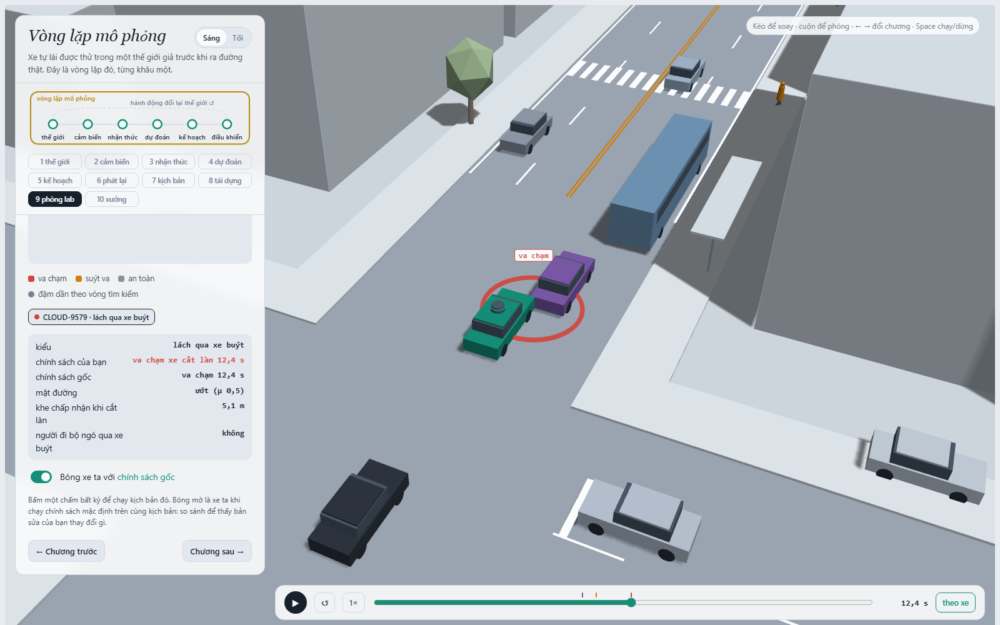
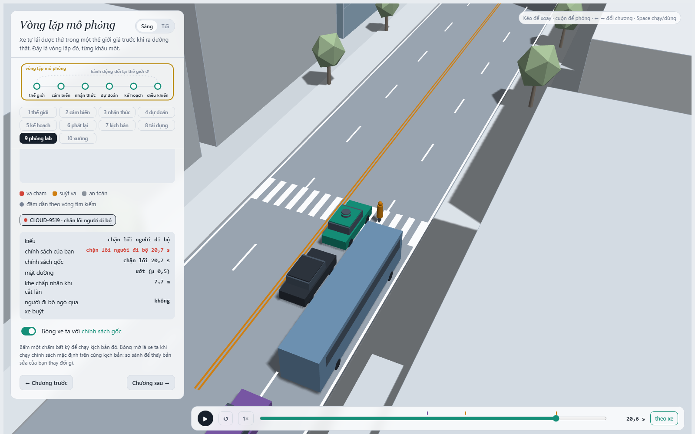
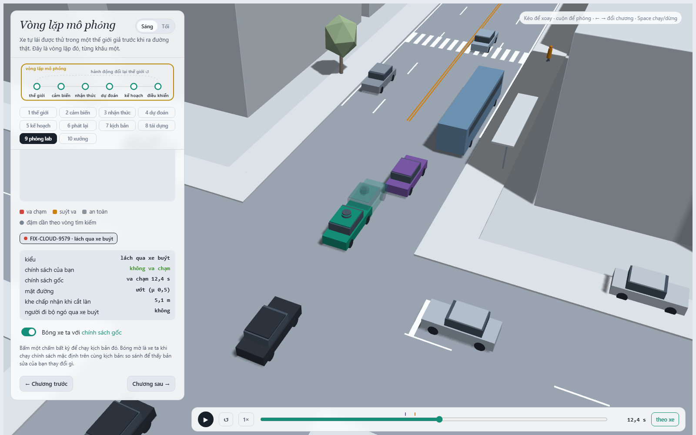
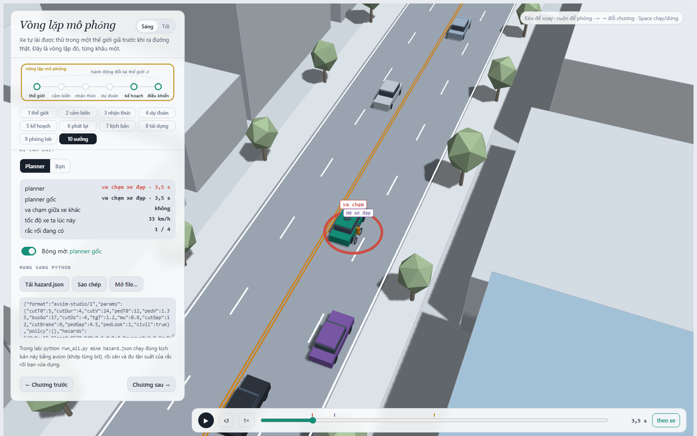

MSSV: 2A202602524

# Lab 11 · Scenario Forge — báo cáo

Họ tên (theo tên đã cung cấp): DinhBaoHung. Tên thư mục nộp: `K4-DAY11-DinhBaoHung-2A202602524`.

Thị trấn **B** (`meta.json: _run.town`). Toàn bộ bằng chứng pipeline dùng ngân sách đầy đủ, `_run.quick = false`, không salt TEST. Seed: `{"mc": 1298154292, "search": 2680305939, "test": 2414656727}` (`meta.json: seeds`). Không sửa `avsim/`, `run_all.py`, `tests/` hoặc phân phối tự nhiên.

MSSV có chữ A nên parser dòng đầu của bản gốc không nhận. Lần chạy dùng biến môi trường có sẵn `LAB11_MSSV=2A202602524` để giữ nguyên cả MSSV khi băm seed, đúng cơ chế grader. Trên PowerShell chạy `$env:LAB11_MSSV='2A202602524'; python run_all.py all`, hoặc `./run_lab.ps1 all` trong repo. Tài liệu khóa học có chỗ gọi kiểu người đi bộ là `dart_out`; báo cáo dùng tên `crosswalk_block` đúng docstring và `MODES` của repo hiện tại.

## 1. Phát lại log có trung thực không?

`replay.json`: `n = 400`, `dropped_human_crash_logs = 1`, `n_used = 399`, `crash_in_both = 0`.

| Cách kiểm thử | Va chạm | front | rear | side |
| --- | --- | --- | --- | --- |
| replay | 112 | 0 | 102 | 10 |
| reactive | 0 | 0 | 0 | 0 |

Nguồn bảng: `replay.json: replay, reactive`. Phần lớn va chạm phát lại là `rear`: TG giữ quỹ đạo của log người lái, không biết planner đã phanh sớm hơn người lái, nên chạy xuyên vào xe ta. Trong mô phỏng phản ứng, TG nhận xe ta là xe trước và phanh theo IDM. Vì hành vi còn lại bị đóng băng, đây là lỗi đánh giá bằng log, không đủ để kết luận planner gây những tai nạn đó ngoài đường.

Ví dụ `replay.json: replay_only`, scenario **7**, contact `rear`, `min_ttc_reactive = 2.40524144` s. Chạy kiểm tra lại đúng tham số đã lưu: log người lái và thế giới phản ứng không có sự kiện ego; phát lại có ego–TG tại **17.65 s**, cờ `fake = true`. Chi tiết lần kiểm tra thêm này nằm ở `inspection.json: replay_example`, không phải mẫu mới được thêm vào tổng 400.

## 2. Kịch bản bất khả thi

`is_feasible` áp dụng bốn luật: gia tốc ngang cực đại của chuyển làn cosin `π²·3,5/(2·cutDur²) ≤ μg`; phanh sau chuyển làn `cutBrake ≤ μg`; tốc độ người đi bộ `pedV ≤ 2,5 m/s`; tốc độ xe cắt làn `0 < cutV ≤ 22 m/s`. Hai luật đầu giới hạn lực bám lốp; luật ba giới hạn mô hình người đi bộ đang đi; luật bốn loại tốc độ không hợp lệ hoặc ngoài miền xe của lab. Hàm cũng từ chối thời gian chuyển làn hoặc hệ số ma sát không dương để tránh phép chia vô nghĩa.

| Cuộc săn | Kịch bản bị loại |
| --- | --- |
| bus_bypass | 4 |
| cut_in | 5 |
| crosswalk_block | 14 |
| rear_ended | 11 |

Nguồn: `hunt.json: <mode>.infeasible`. Nhiều nhất là **crosswalk_block**. CEM tăng điểm nguy hiểm bằng cách làm chuyển làn nhanh hơn hoặc thay đổi điều kiện bám đường; những tổ hợp không thể thực hiện thường có điểm rất cao. Phải lọc trước khi mô phỏng và trước khi khớp elite. Đếm chúng là thất bại sẽ tăng giả rủi ro vật lý; loại rồi vẫn chia theo toàn bộ số lần rút mẫu đúng theo pipeline của lab, không tự thay phân phối bằng phân phối có điều kiện khả thi.

## 3. Monte Carlo cho biết gì?

`mc.json: crashes = 0`, `n = 3000`, `infeasible = 16`. Tần suất quan sát `k/n = 0`; đây chỉ là ước lượng mẫu. Khoảng Wilson 95% là **[0, 0.00127889566]** (`lo, hi`): chưa quan sát được va chạm, vẫn phải báo **p ≤ 0.00127889566**, không kết luận xác suất thật bằng 0.

Cả bốn kiểu được săn và `other` đều chưa xuất hiện; mỗi kiểu có cùng cận Wilson trên 0.00127889566 (`mc.json: per_mode`). Các cận riêng không được cộng rồi coi đó là cận đồng thời 95%.

Để sai số nửa khoảng xấp xỉ bằng 20% của p, giải `1,96·sqrt(p(1-p)/n) ≤ 0,2p`: `n ≈ 96(1-p)/p ≈ 96/p` khi p hiếm. Không thể thế tần suất quan sát bằng 0 vào công thức để ra một ngân sách hữu hạn. Nếu lập kế hoạch bằng trung vị IS ở câu 4, p ≈ 0.000590454008, cần khoảng **162,587** mẫu MC. Đây là phép dự toán dùng p ước lượng, không phải chứng nhận độ chính xác.

## 4. Importance sampling, ESS và suy biến

Đề xuất phòng thủ `q = 0,8·q_CEM + 0,2·p`; trọng số `w=p/q`, ước lượng không tự chuẩn hóa `mean(w·y)`. Nhờ `q ≥ 0,2p`, w không vượt 5. Các số dưới đây lấy từ `estimate.json: seeds[seed].per.<mode>`; dòng không hit ghi cận `upper_zero_hits`, không diễn giải giá trị mẫu 0 thành xác suất thật 0.

| Seed | Kiểu | p / cận trên | hits | ess | top_share |
| --- | --- | --- | --- | --- | --- |
| 0 | bus_bypass | 0.00111735361 | 48 | 123.473309 | 0.19553084 |
| 0 | cut_in | chưa thấy; ≤ 0.025 | 0 | 121.480588 | 0 |
| 0 | crosswalk_block | 9.10790868e-07 | 38 | 111.473157 | 0.603623245 |
| 0 | rear_ended | chưa thấy; ≤ 0.025 | 0 | 120.267587 | 0 |
| 1 | bus_bypass | 0.000584025332 | 34 | 141.685246 | 0.434476536 |
| 1 | cut_in | chưa thấy; ≤ 0.025 | 0 | 133.101517 | 0 |
| 1 | crosswalk_block | 6.42867556e-06 | 54 | 119.245558 | 0.55056897 |
| 1 | rear_ended | chưa thấy; ≤ 0.025 | 0 | 113.968536 | 0 |
| 2 | bus_bypass | 0.000568577414 | 38 | 123.098668 | 0.54193252 |
| 2 | cut_in | chưa thấy; ≤ 0.025 | 0 | 113.543567 | 0 |
| 2 | crosswalk_block | 3.03970557e-06 | 45 | 127.571101 | 0.773567296 |
| 2 | rear_ended | chưa thấy; ≤ 0.025 | 0 | 117.389384 | 0 |

| Seed | total | lo | hi |
| --- | --- | --- | --- |
| 0 | 0.0011182644 | 0.000328381326 | 0.00318704314 |
| 1 | 0.000590454008 | 6.06303793e-05 | 0.0023991733 |
| 2 | 0.000571617119 | 0 | 0.00246979586 |

Nguồn bảng tổng: `estimate.json: seeds`. Trung vị tổng **0.000590454008**; các seed có tỷ số tổng lớn nhất/nhỏ nhất **1.9563172**. Cận MC 0.00127889566 không bác bỏ các ước lượng dương nhỏ hơn nó, nhưng MC không đủ dữ liệu để xác nhận độ chính xác của IS.

Các dòng `top_share > 0,5`: **seed 0 / crosswalk_block: 0.603623245; seed 1 / crosswalk_block: 0.55056897; seed 2 / bus_bypass: 0.54193252; seed 2 / crosswalk_block: 0.773567296**. `top_share` là `max(wy)/sum(wy)`: vượt 0,5 nghĩa là hơn nửa ước lượng đến từ đúng một mẫu, nên khoảng ±1,96·se có thể tạo cảm giác chắc chắn quá mức. ESS đo độ lệch của toàn bộ trọng số, không phải số lần thử độc lập của biến cố. `top_share` nhỏ cũng không chứng minh q đã phủ hết vùng tai nạn. Với 0 hit và n=600, cận đúng của hỗn hợp phòng thủ là **3/(0,2·600) = 0,025**, không phải 3/ESS.

Các trường `lo, hi` tổng ở bảng là kết quả xấp xỉ mà pipeline xuất, không chứng nhận tổng rủi ro: `run_all.py` cộng cận `other` khi 0 hit nhưng chưa cộng cận 0,025 của hai kiểu IS chưa thấy. Vì thế không được dùng riêng `seeds[].hi` để tuyên bố mọi kiểu còn lại đều nằm dưới nó.

`estimate.json: budget = 16800` lần mô phỏng dự kiến: 4·(8·300 + 3·600), gồm cả huấn luyện đề xuất; không bao gồm bước fix và MC. So với dự toán MC ±20% ở câu 3, tỷ số ngân sách khoảng **9.67779762**. Không thể khẳng định IS đã đạt cùng độ chính xác: độ rộng IS chỉ xấp xỉ và các seed có thể bỏ sót vùng nguy hiểm khác nhau.

Để so đúng **cùng độ chính xác xấp xỉ đang quan sát**, lấy `se_total = sqrt(sum(per.<mode>.se²))`, dự toán `n_MC ≈ p(1-p)/se_total²` theo p của từng seed. `other` chưa có hit nên số hạng phương sai mẫu của nó bằng 0; phép dự toán này cũng chưa chứng nhận các vùng chưa quan sát.

| Seed | Nửa khoảng 1,96·se / total | MC cần xấp xỉ để có cùng se |
| --- | --- | --- |
| 0 | 0.706347331 | 6878 |
| 1 | 0.897315661 | 8076 |
| 2 | 1.08338791 | 5723 |

Với ngân sách săn và IS chung 16800 mẫu, các con số trên không chứng minh tiết kiệm mẫu so với MC ở độ chính xác thô hiện có. Lợi ích rõ là tìm được cơ chế thất bại để sửa và quan sát nhiều ca hiếm; không được đánh đồng số hit cao với một ước lượng tổng chính xác.

Phần `other` lấy trực tiếp từ `mc.json`, vì nó gom nhiều cơ chế không có một điểm nguy hiểm riêng để săn. `estimate.json: other.k = 0`, `other.n = 3000`, `other.hi = 0.00127889566`; khi chưa có hit, báo cận trên này. Pipeline vẫn cộng cận đó vào đầu trên của khoảng tổng; tổng điểm ước lượng là tổng các kiểu và phần ước lượng `other`, không âm thầm bỏ một phần của tập thất bại.

## 5. Các kiểu thất bại và ảnh 3D

| Cuộc săn nhắm vào | Các kiểu thực sự tìm được |
| --- | --- |
| bus_bypass | `{"bus_bypass": 180}` |
| cut_in | `{"bus_bypass": 35}` |
| crosswalk_block | `{"bus_bypass": 8, "crosswalk_block": 15}` |
| rear_ended | `{"bus_bypass": 16, "crosswalk_block": 2}` |

Nguồn: `hunt.json: <mode>.found`. Bảng đếm mọi thất bại tìm được trong từng cuộc săn, không mặc định chúng đều đúng kiểu đích. `cut_in` và `rear_ended` không được xác nhận chỉ vì cuộc săn tương ứng tìm thấy va chạm kiểu khác. Không tìm ra không chứng minh không tồn tại; xem cận không hit ở câu 4.

Nguồn: `cloud.json`, hàng 9579, tham số nguyên độ chính xác; kiểm tra thêm ở `inspection.json: mode_examples`. C2 tìm khe để lách xe buýt dừng trong E2, lấn sang hành lang ego; ego gặp C2 ở x=94.993 m, v=1.468 m/s. Sự kiện đầu tiên là ego–C2, đúng điều kiện x<112 và v<6 của bus_bypass. Các tác nhân chạy phản ứng, không phải phát lại log. Sự kiện `contact` tại **12.4 s**.

Nguồn: `cloud.json`, hàng 9519, tham số nguyên độ chính xác; kiểm tra thêm ở `inspection.json: mode_examples`. P1 chờ đến thời điểm/khe nhìn thấy đủ để qua đường; tham số pedLook=0, mu=0.5. Xe buýt che tầm nhìn từ phía vạch; ego phanh muộn và dừng thân xe trên lối P1. P1 dừng trước thân xe, không đi xuyên vào xe; đây là lỗi chặn lối khi kind=block, không tự diễn giải nó thành tiếp xúc vật lý. Sự kiện `block` tại **20.65 s**.

Một cuộc săn chung dễ hội tụ vào lách xe buýt vì nó cho điểm nguy hiểm tốt trước; tăng tỷ lệ va chạm trong elite không bảo đảm tăng độ phủ kiểu thất bại. Vì vậy tách cuộc săn theo từng kiểu, kiểm tra nhãn của sự kiện đầu tiên và giữ hỗn hợp phòng thủ khi ước lượng. Ảnh được xuất bằng Chromium headless từ trình xem và lõi JS gốc; không dùng ảnh ví dụ của giảng viên. Thời điểm chụp và nguồn tham số được ghi trong `shots/manifest.json`.

## 6. Sửa planner: TRAIN và TEST

Policy được chọn: **`{"cutinLat": 3.0}`**, chỉ xếp hạng TRAIN theo cận trên, ràng buộc giữ ít nhất 95% tiến độ baseline và hòa thì ưu tiên tiến độ cao hơn. Các ứng viên là danh sách gốc; không đổi ứng viên sau khi đọc TEST.

| Tập / policy | fail | fail_hi_seen | fail_hi | progress (m) | harsh (khung/lần chạy) |
| --- | --- | --- | --- | --- | --- |
| TRAIN baseline | 0.00117452278 | 0.0019692632 | 0.0019692632 | 212.706119 | 8.171875 |
| TRAIN chosen | 3.00076928e-07 | 5.60046623e-07 | 5.60046623e-07 | 212.54742 | 8.05859375 |
| TEST baseline | 0.00078904811 | 0.00148730406 | 0.00276619973 | 215.696607 | 8.22133333 |
| TEST chosen | 8.27890792e-07 | 1.3930107e-06 | 0.0387802887 | 215.704144 | 7.822 |

Nguồn: `fix.json: baseline_train, chosen, baseline_test, chosen_test`. Trên TRAIN, baseline tiến được 212.706119 m, ngưỡng lựa chọn 202.070813 m. Trên TEST, mức mất quãng đường tương đối **-0.00349427521%** (âm nghĩa là tăng). `harsh` là **số khung có a < −3 m/s²**, không phải số đợt phanh rời nhau. Khoảng cách chỉ tính đến lần thất bại đầu tiên.

TEST dùng seed mới và săn lại riêng dưới từng policy; tập tự nhiên TEST có 3.000 lần để kiểm tra tiến độ và mọi tai nạn ngoài hai kiểu được retarget. `chosen_test.unseen` = `["bus_bypass"]`. Một kiểu 0 hit vẫn đóng góp 3/(0,2·400)=0,0375 vào `fail_hi`; các tai nạn khác cộng cận Wilson từ mẫu tự nhiên. Vì vậy `fail_hi` của bản sửa có thể lớn hơn ước lượng điểm baseline dù bản sửa thực sự tốt hơn: dữ liệu còn thiếu để chứng nhận một kiểu đã biến mất. `fail_hi_seen` chỉ cho biết phần có hit; không dùng nó làm cận an toàn của cả policy.

Ví dụ ngay trên TRAIN (`fix.json: table`): cautionV=6.0 có fail=0.000641713467, cao hơn cautionV=6.5 với fail=0.000632435958. Giảm tốc gần vạch không bảo đảm giảm rủi ro: ego đến trạm muộn hơn, thay khe C2 chấp nhận và thời điểm P1 bước ra; phanh sớm cũng thay hành vi TG. Bảng xác nhận thứ tự thất bại thay đổi; đây là giải thích cơ chế có thể xảy ra, không suy ra nhân quả của một tương tác cụ thể chỉ từ tổng số.

Cùng tham số từ `cloud.json` hàng 9579: baseline gặp `contact` tại 12.4 s, bản sửa không có sự kiện ego. Ảnh tại thời điểm baseline thất bại, **xe đặc là policy được chọn, bóng mờ là baseline** (`inspection.json: fix_example`).

## 7. Từ mô phỏng ra đường thật

Ba giả định quan trọng trong `avsim/space.py`, với dữ liệu cần thu để thay chúng:

| Giả định | Dữ liệu và nơi lấy | Hướng sai lệch cần kiểm tra |
| --- | --- | --- |
| Thị trấn B dùng `cut_gap_median=12 m`, khe chấp nhận lognormal, sigma=0,5 | Video drone/camera ven đường trên đoạn có xe buýt; theo dõi quỹ đạo để đo khe trước/sau đúng lúc người lái quyết định nhập làn, có cả các ca từ chối nhập | Nếu thực tế chấp nhận khe nhỏ hơn, mô phỏng có thể đánh giá thấp lách xe buýt; khe lớn hơn có thể làm giảm cơ chế này. Cần kiểm tra lại vì thay khe cũng đổi thời điểm nhập. |
| Xác suất `pedLook=1` là 0,85 | Camera hai phía trạm xe buýt, gán nhãn người có nhìn qua xe buýt trước khi bước hay không, cùng hướng nhìn và thời điểm xe đến | Nếu người nhìn kiểm tra ít hơn giả định, các lần bước ra khi bị che và chặn vạch có thể bị đánh giá thấp; phải tách theo loại xe buýt và bề rộng đường. |
| Đường ướt xác suất 0,30; μ cố định 0,5 khi ướt và 0,8 khi khô | Nhật ký thời tiết cộng thời lượng/số chuyến trên đoạn đường; thử phanh có kiểm soát với cùng lốp, tải và mặt đường để ước lượng phân phối μ | Nếu đường thực tế trơn hơn hoặc ướt thường xuyên hơn, mô hình có thể đánh giá thấp quãng phanh và chặn vạch. μ cao hơn có thể giảm kiểu này nhưng vẫn phải kiểm tra tương tác với xe bám đuôi. |

Đây là kế hoạch thu dữ liệu, không tuyên bố đã có các khảo sát đó. Các hướng trên là giả thuyết theo cơ chế vật lý, không phải bảo đảm đơn điệu trong thế giới có tác nhân phản ứng.

## 8. Giới hạn

1. Bản đồ chỉ có một phố, một nút giao và một vạch qua đường ở x=122 m; con số không đại diện đường cong, nhiều giao lộ, cao tốc hoặc mạng lưới giao thông khác.
2. Xe còn lại theo IDM và quy tắc chấp nhận khe; người đi bộ dừng trước thân xe thay vì cứ đi xuyên vào xe. Vì vậy `block` là lỗi chặn lối, không được gọi tất cả các sự kiện đó là tai nạn tiếp xúc hoặc suy ra mức thương tích.
3. Planner biết vị trí/tốc độ gần như hoàn hảo ngoài che khuất hình học của mô hình. Chưa có sai số phát hiện, bám vết, độ trễ cảm biến hoặc bám đường ngẫu nhiên theo thời gian; thời lượng chỉ 24 s nên không đo rủi ro cả hành trình dài.

Nếu có thêm một tuần: tăng số seed và mẫu phòng thủ cho các kiểu 0 hit; thu video tại một trạm xe buýt để khớp khe, nhìn kiểm tra và độ ướt; sau đó đo lại trên một nút giao chưa dùng để chọn policy, có nhiễu/độ trễ cảm biến. Không dùng TEST hiện tại để chọn lại policy.

## 9. Rắc rối tự thiết kế: xe đạp lạng sang làn xe ta

Xe đạp H0 đi chậm trong E2, bắt đầu lạng sang E1 khi ego tiến gần, mô phỏng né vật cản mép đường. Cảnh cụ thể nằm trong `hazard.json`: x=−15 m, v=4 m/s, d=0,4 m, swerve=3,8 m, swDur=2,7 s, trig=12 m. Ego bắt đầu x=−40 m. Planner dễ phản ứng muộn vì xe đạp chưa lọt vào hành lang xe trước cho đến khi đang lấn ngang; giảm tốc gần vạch xe buýt không giải quyết một xung đột ngang xuất hiện trước vạch.

`space` quét x từ −25 đến 20 m (trước ego 15–60 m), v 2–6 m/s, khoảng kích hoạt 8–22 m, lệch ngang 3,6–4,0 m trong 2,7–3,2 s. Các khoảng phủ cả tiếp cận gần/xa và lạng sớm/muộn; lấy đều là thiết kế thí nghiệm, không nhận là phân phối đo thực tế. Gia tốc ngang lớn nhất π²·4/(2·2,7²)≈2,708 m/s², dưới trần 3 m/s² của `studio` và dưới μg trên đường ướt. Khoảng tham số khác ví dụ trong README và mọi tổ hợp của riêng xe đạp nằm trong giới hạn vật lý.

**Căn cứ và giới hạn exposure:** `hazard.json: why` ghi rõ exposure=0,001 là giả định minh họa, từ 1 đoạn tương tự/chuyến × 0,01 cơ hội gặp xe đạp chậm × 0,10 xác suất lạng khi gặp. Hai xác suất thành phần chưa có khảo sát thực tế; không gọi tích này là tần suất thực nghiệm. Kết quả có thể so trong mô hình giả định, còn muốn kết luận ngoài đường phải thay bằng số xe đạp lạng chia cho số chuyến quan sát. Với exposure=0,0001 hoặc 0,01, tần suất suy ra thay đổi đúng 10 lần. Giới hạn dữ liệu này không được che bằng một con số trông chính xác.

`mine.json: world` = `"town"`, `accepted = 0.992` (99.200%), `infeasible = 12`. Cảnh chính xác từ chương 10: `exact.planner` = `[["ego", "H0", 3.45]]`; đối chiếu ảnh ở dưới. Các số quét dùng giao thông tự nhiên thị trấn B, không giữ nguyên một cảnh giao thông duy nhất.

| Policy | n | crashes | avoidable | unavoidable | unattributed | low_speed | avoidable_foreknown |
| --- | --- | --- | --- | --- | --- | --- | --- |
| baseline | 1488 | 762 | 750 | 9 | 3 | 0 | 759 |
| chosen | 1488 | 571 | 563 | 8 | 0 | 0 | 571 |

| Policy | P(lỗi planner \| hazard) | Wilson lo | Wilson hi | Tần suất/chuyến giả định | Cận/chuyến giả định |
| --- | --- | --- | --- | --- | --- |
| baseline | 0.504032258 | 0.478650112 | 0.529393637 | 0.000504032258 | 0.000529393637 |
| chosen | 0.378360215 | 0.354061156 | 0.403285736 | 0.000378360215 | 0.000403285736 |

Nguồn hai bảng: `mine.json: baseline, chosen`. `avoidable` là toàn bộ va chạm biến mất khi phanh ở giới hạn lốp ngay từ khung đầu tiên rắc rối đã bắt đầu **và** nhìn thấy; `unavoidable` là vẫn va chạm trong phép đối chứng phanh; `unattributed` không quy cho H0 (ví dụ ego va chạm với tác nhân khác hoặc H0 chưa bắt đầu). `low_speed` là cờ chồng lên các lớp, không được cộng như một lớp thứ tư. Chênh giữa `avoidable_foreknown` và `avoidable` thể hiện tác động che khuất. Từ “không tránh được” ở đây chỉ có nghĩa không tránh được bằng phép thử phanh đó, không phải định lý rằng mọi hành động đều vô ích.

Tần suất lỗi do hazard với baseline theo exposure minh họa là 0.000504032258/chuyến, bản sửa 0.000378360215/chuyến. Đặt cạnh `bus_bypass` baseline trong `estimate.json`, trung vị **0.000584025332** mỗi kịch bản 24 s. Đây là so sánh theo quy ước một đoạn mô phỏng/chuyến; không đồng nhất xác suất trên một đoạn với rủi ro cả chuyến nhiều đoạn hoặc rủi ro thực nghiệm ngoài đường.

Ảnh chương 10 ở t=3,45 s, cùng `hazard.json`; giao diện làm tròn thành 3,5 s. Không có bản ghi người dùng tự lái nên không khẳng định người dùng đã tránh được. Phép đối chứng phanh tự động không thay cho thử nghiệm lái của con người.

Kiểm tra bổ sung `validation.json: screenshot_scene_parity`: trạng thái Python/JS khớp hoàn toàn đến khung va chạm của cảnh hazard, và mọi cặp/thời điểm/loại sự kiện trong toàn lần chạy đều khớp. Riêng sau va chạm, tại 22,7 s gia tốc H0 trong hai lõi được cung cấp lệch tối đa khoảng 0,0368 m/s²; sai lệch vị trí toàn lần chạy tối đa khoảng 1,34 mm. Vì vậy không nhận riêng cảnh hazard này khớp từng bit trên mọi đại lượng sau va chạm. Không sửa hai lõi để che khác biệt đó. Hai ảnh kiểu thất bại và cảnh bản sửa khớp toàn quỹ đạo trong lần kiểm tra bổ sung.

“Tránh được” là chuẩn lạc quan vì oracle nhận biết đúng ngay khi nhìn thấy và lập tức dùng phanh cực đại, bỏ qua trễ nhận thức/quyết định nên có thể đếm nhiều ca hơn planner thực tế cứu được. Ngược lại, oracle chỉ thử phanh, không đánh lái, nên bỏ sót ca có thể cứu bằng đổi hướng. Hai hiệu ứng ngược nhau; không quy toàn bộ phần còn lại thành lỗi bất khả kháng.

Cách sửa cụ thể: dự đoán bao chiếm chỗ ngang của xe đạp trong 2–3 s từ vận tốc ngang/diễn biến làn; nếu bao này cắt hành lang ego, tính TTC với vận tốc tương đối và phanh sớm trước khi tâm xe đạp lọt vào ngưỡng `cutinLat`. `cutinLat` lớn hơn là một thử nghiệm TRAIN hợp lý, nhưng có thể phanh vì cả xe làn bên không định nhập; cần kiểm tra tiến độ và nguy cơ bị đâm sau. Các núm gần vạch không thay thế được dự đoán chuyển động ngang. Muốn chọn thêm policy phải dùng TRAIN mới rồi TEST mới, không quay lại chọn từ TEST đã báo.
